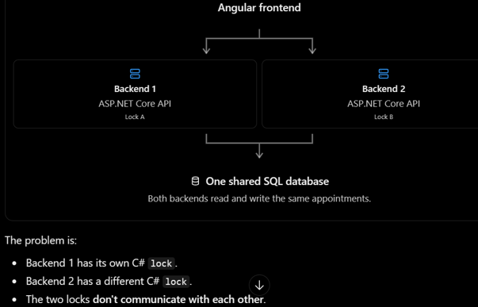
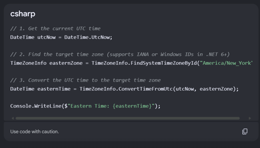

# Part A — Clinic Bug Reports and Fixes

Brief summary of each reported issue, its cause, the changes made, and the regression test.

## CLINIC-101 — Two Receptionists Booked the Same Slot
- **Reported issue:** Two receptionists booked Dr. Sarah Ahmed for 10:00 at almost the same time. Both bookings succeeded instead of one receiving a "slot taken" error.
- **Root cause:** A **race condition**: two requests could check that a slot was free before either request saved its appointment.
- **Fix:** Added a shared `BookingLock` to `DataStore` and used C# `lock` around the conflict check and appointment creation. This allows only one request at a time through that critical section; the second receives **409 Conflict**.
- **Test:** `CLINIC101()` in `Clinic101Tests.cs` runs two simultaneous booking attempts and expects exactly one **201 Created** and one **409 Conflict**.
- **Reference:**\
Race Condition error\
\
Wouldn’t work later on because two separate ASP.NET API servers during two separate bookings don’t communicate\
\

> **Future Improvements (During Part B):**
>- **Current limitation:** The C# lock prevents simultaneous bookings within a single ASP.NET Core application instance because all requests share the same BookingLock object.
>- **Impact:** If the application runs on multiple API servers, each server has its own lock. Two simultaneous requests handled by different servers could therefore both pass the availability check and create conflicting bookings.
>- **Planned improvement:** When moving to a database in Part B, enforce booking consistency using database transactions and appropriate database-level concurrency protection. This ensures conflicting bookings are prevented even when requests are processed by separate API servers.

## CLINIC-102 — Appointments Allowed in the Past
- **Reported issue:** After the API moved to a cloud server, receptionists could book times that had already passed in Kuwait, and morning availability displayed incorrect slots.
- **Root cause:** Booking and availability checks depended on the server's local clock/time zone instead of the clinic's Kuwait time.
- **Fix:** Used `.NET` `TimeProvider` to obtain the current UTC time and `TimeZoneInfo` (`Asia/Kuwait`) to convert it into Kuwait time before validating bookings and availability.
- **Test:** `CLINIC102()` in `Clinic102Test.cs` uses a fake UTC clock to check that a 10:00 Kuwait booking is rejected when Kuwait time is already 11:00.
- **Reference:** 

## CLINIC-103 — Missing Gender Saved as Female
- **Reported issue:** Patients registered by the kiosk without a gender were automatically saved as Female.
- **Root cause:** The C# gender enum originally used **0 = Female**; a missing enum value also defaulted to **0**.
- **Fix:** Added `NotSpecified = 0` to `GenderOption` and rejected missing/invalid gender values with **400 Bad Request**. Updated the Angular gender dropdown to match **1 = Female** and **2 = Male**.
- **Test:** `CLINIC103()` in `Clinic103Test.cs` omits gender and expects registration to fail without saving the patient.

## CLINIC-104 — Duplicate Patient Records
- **Reported issue:** A returning patient could be registered multiple times, leaving previous visits split across separate records.
- **Root cause:** Patient registration did not have a unique identifier or check whether the person already existed.
- **Fix:** Added a 12-digit `CivilId` field, validated its format, and returned **409 Conflict** if that Civil ID was already registered. The current Angular booking flow still creates a patient each time; searching for and reusing an existing patient record remains to be implemented.
- **Test:** `CLINIC104()` in `Clinic104Tests.cs` tries to register two patients with the same Civil ID and expects one saved record and a **409 Conflict** on the second request.

> **Remaining work:**
>- **Current limitation:** The backend now prevents duplicate patient records by checking whether the Civil ID already exists. However, the Angular frontend still attempts to register a new patient every time an appointment is booked.\
>- **Impact:** When an existing patient tries to book another appointment, the backend returns 409 Conflict because their Civil ID is already registered. As a result, the booking process stops, even though the patient should be allowed to have multiple appointments under the same patient record.
>- **Planned improvement:** Update the frontend to search for existing patients using their Civil ID. If the patient exists, reuse their PatientId when creating the appointment (POST /appointments). Only register a new patient (POST /patients) if no existing record is found.

## CLINIC-105 — Cancel Button Sometimes Does Nothing
- **Reported issue:** After confirming cancellation, a receptionist sometimes saw no change or explanation, and the appointment remained visible.
- **Root cause:** The Angular cancellation error handler only wrote errors to the developer console and did not refresh appointments after a failed request.
- **Fix:** Added a `cancellationError` signal and visible error message in `app.html`, then refreshed the appointments list after cancellation failures as well as successes.
- **Test:** `should show an error and refresh after failed cancellation` in `clinic105.spec.ts` simulates a **409 Conflict** and checks the displayed message and list refresh.

