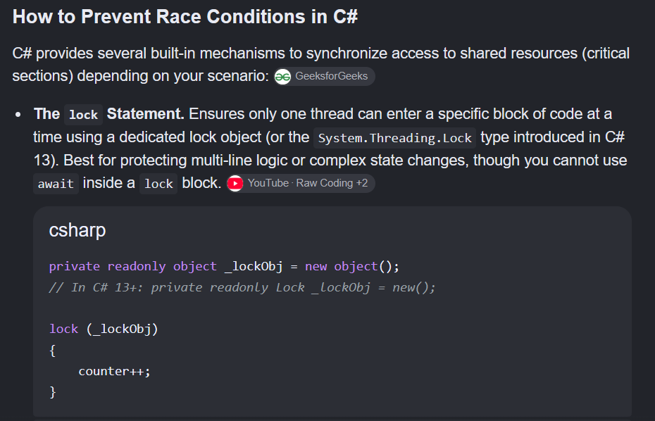
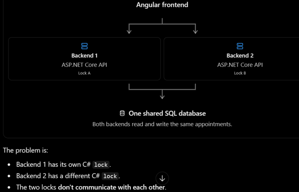
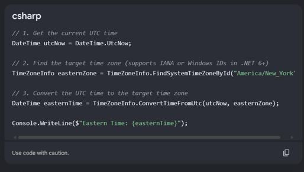
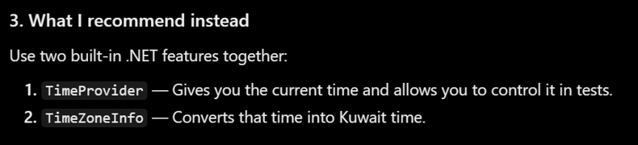

# Part A — Clinic Bug Reports and Fixes

Brief summary of each reported issue, its cause, the changes made, and the regression test.

## CLINIC-101 — Two Receptionists Booked the Same Slot
- **Reported issue:** Two receptionists booked Dr. Sarah Ahmed for 10:00 at almost the same time. Both bookings succeeded instead of one receiving a "slot taken" error.
- **Root cause:** A **race condition**: two requests could check that a slot was free before either request saved its appointment.
- **Fix:** Added a shared `BookingLock` to `DataStore` and used C# `lock` around the conflict check and appointment creation. This allows only one request at a time through that critical section; the second receives **409 Conflict**.
- **Test:** `CLINIC101()` in `Clinic101Tests.cs` runs two simultaneous booking attempts and expects exactly one **201 Created** and one **409 Conflict**.
- **Reference:**\
Race Condition error\
\
Wouldn’t work later on because two separate ASP.NET API servers during two separate bookings don’t communicate\
\

> **Future Improvements (During Part B):**
>- **Current limitation:** The C# lock prevents simultaneous bookings within a single ASP.NET Core application instance because all requests share the same BookingLock object.
>- **Impact:** If the application runs on multiple API servers, each server has its own lock. Two simultaneous requests handled by different servers could therefore both pass the availability check and create conflicting bookings.
>- **Planned improvement:** When moving to a database in Part B, enforce booking consistency using database transactions and appropriate database-level concurrency protection. This ensures conflicting bookings are prevented even when requests are processed by separate API servers.

### Updates After Part B
- **Storage and concurrency:** Replaced the in-memory `DataStore`/`BookingLock` approach with PostgreSQL through EF Core's `ClinicDbContext`. A filtered unique index prevents two active appointments for the same doctor at the same start time; a PostgreSQL exclusion constraint also prevents overlapping appointment durations.
- **Final behavior:** `AppointmentsService` checks conflicts before saving and handles database uniqueness/exclusion violations as **409 Conflict**. This database-level protection replaces the earlier single-server C# lock and addresses the multi-server limitation noted above.
- **Updated test:** `CLINIC101_TenParallelBookings_OnlyOneSucceeds()` in `Clinic101Tests.cs` now uses `WebApplicationFactory` and a real PostgreSQL Testcontainer. It sends 10 concurrent HTTP bookings for the same slot and checks for exactly one **201 Created**, nine **409 Conflict** responses, and one stored active appointment.

## CLINIC-102 — Appointments Allowed in the Past
- **Reported issue:** After the API moved to a cloud server, receptionists could book times that had already passed in Kuwait, and morning availability displayed incorrect slots.
- **Root cause:** Booking and availability checks depended on the server's local clock/time zone instead of the clinic's Kuwait time.
- **Fix:** Used `.NET` `TimeProvider` to obtain the current UTC time and `TimeZoneInfo` (`Asia/Kuwait`) to convert it into Kuwait time before validating bookings and availability.
- **Test:** `CLINIC102()` in `Clinic102Test.cs` uses a fake UTC clock to check that a 10:00 Kuwait booking is rejected when Kuwait time is already 11:00.
- **Reference:** 

### Updates After Part B
- **Service refactor:** The Kuwait-time checks now run in `AppointmentsService` rather than directly in an appointment controller. Both booking validation and availability call `KuwaitTimeHelper.GetNow(_clock)`, using the injected `.NET` `TimeProvider` instead of the server's local time.
- **Database and test update:** The regression test `CLINIC102()` in `Clinic102Test.cs` now builds an EF Core in-memory `ClinicDbContext` with a doctor, patient, and Sunday schedule, then injects a fake UTC clock into the service. It checks both that a past booking is rejected and that the corresponding past slot is unavailable while a later slot is available.

## CLINIC-103 — Missing Gender Saved as Female
- **Reported issue:** Patients registered by the kiosk without a gender were automatically saved as Female.
- **Root cause:** The C# gender enum originally used **0 = Female**; a missing enum value also defaulted to **0**.
- **Fix:** Added `NotSpecified = 0` to `GenderOption` and rejected missing/invalid gender values with **400 Bad Request**. Updated the Angular gender dropdown to match **1 = Female** and **2 = Male**.
- **Test:** `CLINIC103()` in `Clinic103Test.cs` omits gender and expects registration to fail without saving the patient.

### Updates After Part B
- **Database integration:** Patient registration now uses `ClinicDbContext` and EF Core instead of the `DataStore`. The existing `GenderOption.NotSpecified = 0` validation remains in `PatientsController`, which returns a field-specific **400 ValidationProblemDetails** response for missing or invalid gender.
- **Updated test:** `CLINIC103()` in `Clinic103Test.cs` now creates an EF Core in-memory database and checks that the `gender` validation error is returned and no patient is saved. The frontend's gender choices still match the updated enum values.

## CLINIC-104 — Duplicate Patient Records
- **Reported issue:** A returning patient could be registered multiple times, leaving previous visits split across separate records.
- **Root cause:** Patient registration did not have a unique identifier or check whether the person already existed.
- **Fix:** Added a 12-digit `CivilId` field, validated its format, and returned **409 Conflict** if that Civil ID was already registered. The current Angular booking flow still creates a patient each time; searching for and reusing an existing patient record remains to be implemented.
- **Test:** `CLINIC104()` in `Clinic104Tests.cs` tries to register two patients with the same Civil ID and expects one saved record and a **409 Conflict** on the second request.

### Updates After Part B
- **Database protection:** Patients are stored in PostgreSQL, and `ClinicDbContext` defines a unique index on `Patient.CivilId`. `PatientsController` checks for duplicates and also catches PostgreSQL unique-index violations, returning **409 Conflict** rather than creating another record.
- **Patient reuse added:** The earlier "Remaining work" item above has now been addressed for Civil ID searches. The receptionist screen calls `GET /patients/search?civilId=...` and reuses an existing patient's ID when booking; it registers a new patient only when no matching Civil ID is found (**404**).
- **Test coverage:** `CLINIC104()` in `Clinic104Tests.cs` uses an EF Core in-memory database to verify duplicate rejection and that only one record is created. This test does **not** itself exercise the PostgreSQL unique index or the frontend patient-reuse flow; those would require separate integration/frontend tests.

## CLINIC-105 — Cancel Button Sometimes Does Nothing
- **Reported issue:** After confirming cancellation, a receptionist sometimes saw no change or explanation, and the appointment remained visible.
- **Root cause:** The Angular cancellation error handler only wrote errors to the developer console and did not refresh appointments after a failed request.
- **Fix:** Added a `cancellationError` signal and visible error message in `app.html`, then refreshed the appointments list after cancellation failures as well as successes.
- **Test:** `should show an error and refresh after failed cancellation` in `clinic105.spec.ts` simulates a **409 Conflict** and checks the displayed message and list refresh.

### Updates After Part B
- **Frontend refactor:** The cancellation handler and its error state moved from the original `app.ts`/`app.html` to the `Receptionist` feature component (`receptionist.ts`/`receptionist.html`). Failed cancellations still display a readable backend message and refresh the appointments list.
- **Cancellation rules:** The API now requires a cancellation reason, rejects cancellations after an appointment has started or if it is already cancelled, and retains cancelled appointments in PostgreSQL using `IsCancelled` and `CancellationReason` instead of deleting their records.
- **Updated test:** `should show an error and refresh after failed cancellation` in `frontend/src/app/clinic105.spec.ts` now tests the `Receptionist` component, supplies a cancellation reason through a mocked prompt, checks that the request includes that reason, and verifies the displayed **409 Conflict** message and refreshed list.
