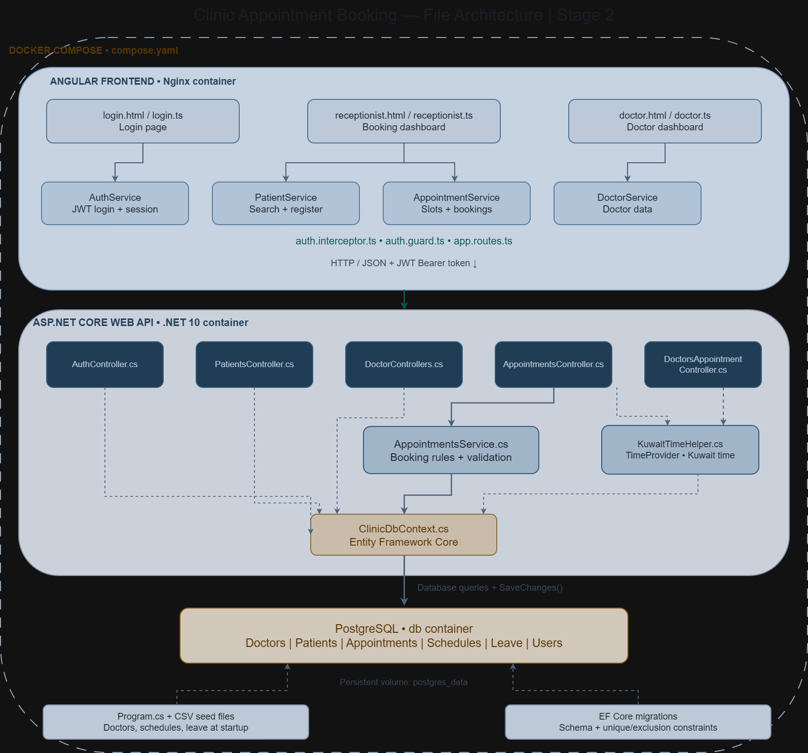
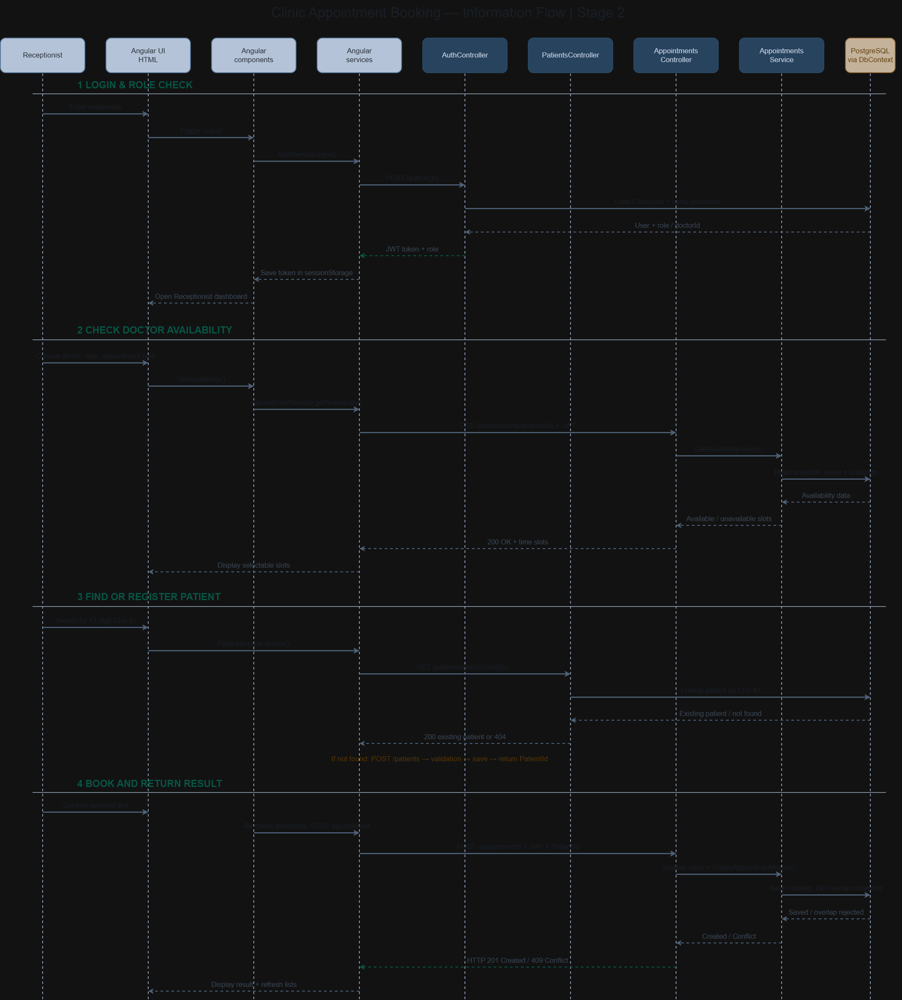

# Design — Clinic Appointment Booking (Stage 2)

This document summarizes the updated application architecture and the main technical decisions made when moving from the Stage 1 prototype toward a production-ready system.

## 1. System Architecture

### File and container architecture

The application uses **three Docker Compose services**: an Angular frontend served through Nginx, an ASP.NET Core (.NET 10) API, and a PostgreSQL database with a persistent Docker volume. The Angular application is split into Login, Receptionist, and Doctor pages, with dedicated services for HTTP requests. On the backend, controllers handle requests and responses; `AppointmentsController` delegates booking rules to `AppointmentsService`, which uses Entity Framework Core through `ClinicDbContext` to access PostgreSQL. Other controllers, including patient and authentication endpoints, also access `ClinicDbContext` directly. The main data models are `Doctor`, `Patient`, `Appointment`, `DoctorSchedule`, `DoctorLeave`, and `ClinicUser`.

At startup, EF Core migrations update the database schema, and CSV seed files provide the initial doctors, working schedules, and leave days. Login accounts are seeded using passwords provided through configuration/environment variables.

### Information flow — booking an appointment

A receptionist first logs in and receives a JWT. The Angular HTTP interceptor attaches the token to protected API requests. When the receptionist chooses a doctor, date, and appointment type, the API checks availability using the doctor's schedule, leave days, existing appointments, and Kuwait time. The receptionist then searches for the patient's Civil ID, reuses an existing record or registers a new patient, and submits the booking. The API validates the request, saves it through EF Core, and returns either a successful booking or a clear error.

## 2. Key Design Decisions

### 2.1 Preventing double bookings

In Part A, I initially used a C# `lock` around the booking check and save operation, but that only protects requests handled by the same API instance. In Part B, I moved appointment storage to PostgreSQL and added a filtered unique index for a doctor's active appointments at the same start time, as well as an exclusion constraint to prevent overlapping appointment durations. `AppointmentsService` also checks for doctor and patient overlaps before saving; if PostgreSQL rejects a doctor conflict, the API returns **409 Conflict**. This provides database-level protection against conflicting doctor bookings even when requests are handled concurrently.

### 2.2 Handling Kuwait time

The clinic's booking rules must use Kuwait time regardless of the server's configured time zone. Instead of calling `DateTime.Now` directly in the booking rules, I inject .NET's `TimeProvider` and use `KuwaitTimeHelper` to convert the current UTC time to `Asia/Kuwait`. The same helper is used when checking whether a slot has passed and whether an appointment can still be changed. Appointment start times are stored as Kuwait-local date/time values in a PostgreSQL `timestamp without time zone` column.

### 2.3 Authentication and roles

`AuthController` checks login credentials against stored password hashes and issues a signed JWT containing the user's role and, for a Doctor, their doctor ID. The two roles are **Receptionist** (book, reschedule, and cancel appointments) and **Doctor** (view their own appointments and update their status). Angular route guards and an HTTP interceptor help manage navigation and authenticated requests, but the actual permissions are enforced by `[Authorize]` attributes and doctor-ownership checks in the backend. This prevents a doctor from accessing another doctor's appointments simply by changing the URL.

### 2.4 One thing I would do differently

If I were starting again, I would separate the booking logic from the controllers and plan the data-access layer earlier. Stage 1 used a simple in-memory `DataStore`, which was appropriate for the first assessment, but moving to PostgreSQL and adding more booking rules required substantial refactoring. Introducing clearer service boundaries from the beginning would have made the transition to Stage 2 easier and the rules simpler to test independently.

## 3. Current Limitations

- The **doctor-overlap rule** is protected by PostgreSQL constraints, but the **patient-overlap rule** is currently checked in application code. Simultaneous requests for the same patient with different doctors may therefore need additional database-level concurrency protection.

These items are separate from the five Part A bug fixes and should also be reflected in the pull request's unfinished-work notes.
