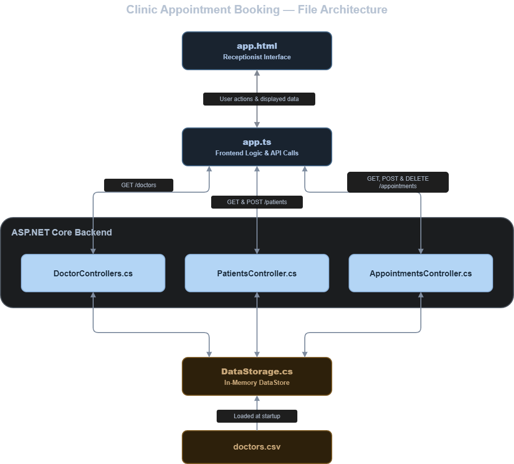
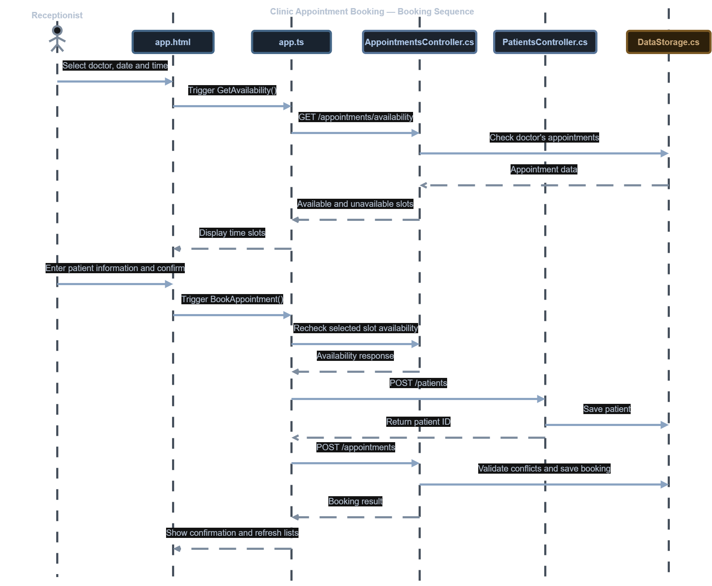

# Clinic Appointment Booking

A small full-stack web application for a clinic receptionist to view doctor availability, register patients, book appointments, and cancel existing bookings.

## Features

- View a predefined list of 20 doctors, including their specialties, gender, and consultation fees.
- Select a doctor and date to see available and unavailable appointment slots.
- Register a patient and book an available appointment.
- View current bookings and cancel appointments.
- Receive validation errors when a booking or patient record does not meet the rules.
- Rebook a time slot after its previous appointment has been cancelled.

## Technology stack

| Layer | Technology |
| --- | --- |
| Frontend | Angular 22, TypeScript, HTML, CSS |
| Backend | ASP.NET Core Web API, .NET 10, C# |
| Data storage | In-memory `DataStore`; doctor records loaded from a CSV file using CsvHelper |
| Backend testing | xUnit |

## Prerequisites

Install the following before running the project:

- **.NET 10 SDK**
- **Node.js compatible with Angular 22**, such as Node.js 24.15.0+ or 22.22.3+ (within those major versions), with npm
- **Git** to clone the repository

## Setup and run

The backend and frontend run separately, so use **two terminals**.

### 1. Start the backend (Terminal 1)

From the repository root (only done first time):

```powershell
cd backend
dotnet run
```

The API runs at **http://localhost:5126**. To check that it is responding, open:

http://localhost:5126/status

The response should be `Backend is working!`.

**Keep this terminal running while using the application.**

### 2. Start the frontend (Terminal 2)

Open a **second terminal** in the repository root:

```powershell
cd frontend
ng serve
```

Open **http://localhost:4200** in your browser. The frontend checks the backend connection when it loads. If the API is offline, it displays a connection error and a **Retry Connection** button.

> **Local port configuration:** The Angular application calls `http://localhost:5126` (configured in `frontend/src/app/app.ts`). The backend permits requests from `http://localhost:4200` through its CORS policy in `backend/Program.cs`. If you change either port, update these settings accordingly.

## How to use the application

1. Select a doctor from the list.
2. Choose an appointment date and click **Check Availability**.
3. Select an available 30-minute slot.
4. Enter the patient's details and click **Book Appointment**.
5. Review and confirm the booking information.
6. View the appointment in **Booked Appointments**, where you can cancel it if needed.

## Booking rules

The backend enforces the following rules:

- Appointments last **30 minutes** and begin on the hour or half hour.
- Clinic hours are **08:00–16:00, Sunday through Thursday**. The last available appointment begins at 15:30.
- A doctor cannot have two active appointments at the same time.
- Past appointment times cannot be booked.
- Cancelling an appointment releases its slot for another booking.

The availability endpoint generates **16 slots per doctor per working day**, marking past or already booked slots as unavailable.

## API endpoints

Base URL: `http://localhost:5126`

| Method | Endpoint | Purpose |
| --- | --- | --- |
| `GET` | `/status` | Check whether the backend is responding |
| `GET` | `/doctors` | List doctors |
| `GET` | `/patients` | List patients |
| `POST` | `/patients` | Register a patient |
| `GET` | `/appointments` | List appointments; optionally filter with `doctorId` and `date` |
| `GET` | `/appointments/availability?doctorId=1&date=2026-10-26` | View a doctor's slots on a date |
| `POST` | `/appointments` | Book an appointment |
| `DELETE` | `/appointments/{id}` | Cancel an appointment |

The API uses appropriate HTTP responses, including **201 Created**, **204 No Content**, **400 Bad Request**, **404 Not Found**, and **409 Conflict**, depending on the request.

## File Architecture


## Flow of Information Architecture


### Project structure

```text
doctor-appointment-webapp/
├── backend/
│   ├── Controllers/            # Doctor, patient, appointment and status API endpoints
│   ├── Data/
│   │   ├── DataStorage.cs      # Shared in-memory data store
│   │   └── doctors.csv         # Predefined doctors
│   ├── Models/                 # Doctor, patient and appointment models
│   └── Program.cs             # API services and CORS configuration
├── frontend/
│   ├── src/app/
│   │   ├── app.ts              # UI state and HTTP requests
│   │   ├── app.html            # Receptionist dashboard
│   │   ├── app.css             # Dashboard styling
│   │   └── models.ts          # Frontend data interfaces
│   └── package.json
└── tests/
    └── DoctorsAppointment.Api.Tests/
        └── UnitTest1.cs       # Backend booking-rule tests
```

## Design decisions

- **Simple controller-based API:** Doctors, patients, appointments, and backend status have separate controllers to keep their responsibilities clear.
- **In-memory storage:** A singleton `DataStore` shares doctor, patient, and appointment lists across requests. Doctors are loaded once at startup from `backend/Data/doctors.csv`. Patient and appointment records are not persisted when the backend stops.
- **Backend to Validate:** Booking restrictions and patient validation are checked by the API. The frontend requests availability and checks the selected slot again before registering the patient and submitting the booking.
- **Angular signals for UI state:** The frontend uses signals to track the selected doctor, date, time, lists, and error messages.
- **Cancellation rather than deletion:** Cancelling changes an appointment's `IsCancelled` flag. Cancelled appointments no longer block availability, and the dashboard displays only active bookings.
- **Clear feedback:** The interface confirms bookings and cancellations and displays API validation errors where handled, rather than silently failing.

## Testing

From the **repository root**, run the backend unit tests with:

```powershell
dotnet test tests/DoctorsAppointment.Api.Tests/DoctorsAppointment.Api.Tests.csproj
```

The eight xUnit tests cover successful booking, invalid slot start times, bookings outside working hours, Friday bookings, double booking, past appointments, the 16:00 boundary, and cancelling then rebooking a slot.

## Limitations and future improvements

This is a local development application, not a production clinic system. With more time, I would:

- **Improve frontend code organisation** by spliting the current Angular frontend into smaller components based on functionality, such as doctors, patients, and appointments. Move API requests into dedicated services to make the code easier to read, maintain, and expand.
- **Add persistent storage** using SQLite and Entity Framework Core so patients and bookings survive restarts.
- **Improve frontend validation** by adding more detailed checks in Angular to provide immediate feedback to users before submitting forms. The backend already enforces these rules, but matching them in the frontend would improve the user experience and reduce unnecessary API requests.
- **Make booking more robust** by combining patient registration and appointment creation into one transaction or workflow, preventing an unused patient record if the final booking fails.
- **Refactor and configure for growth**, moving frontend HTTP calls into dedicated services, splitting up the main component, and moving the API URL into environment-specific configuration. A consistent timezone strategy would also be important.